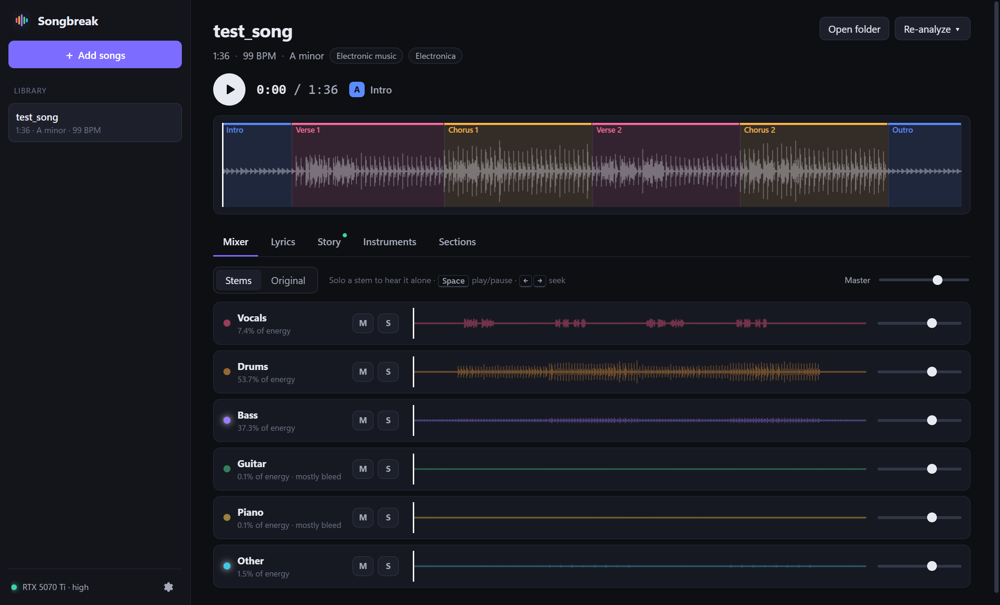
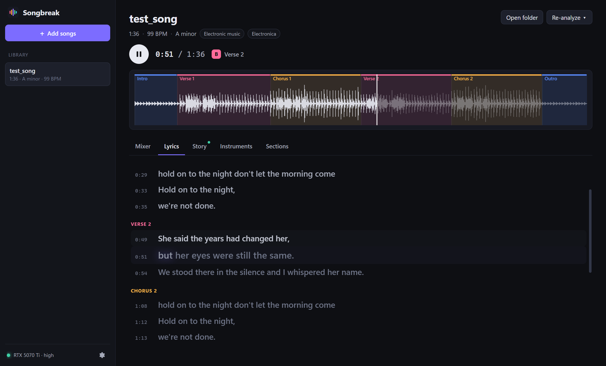
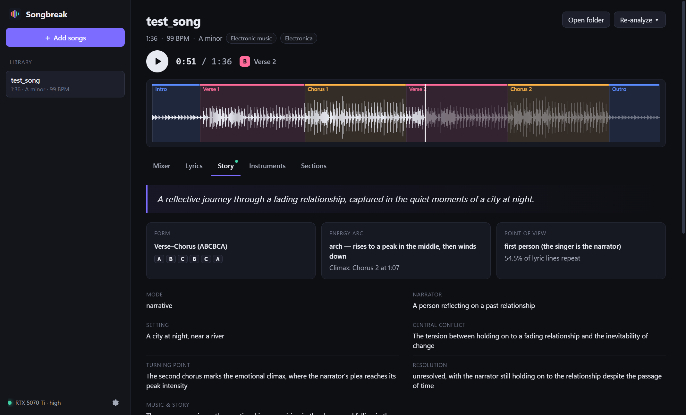
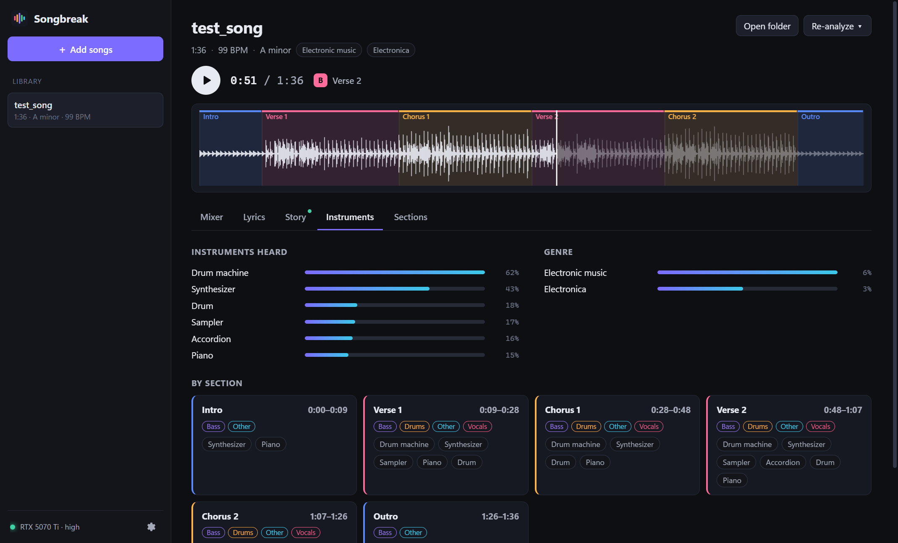
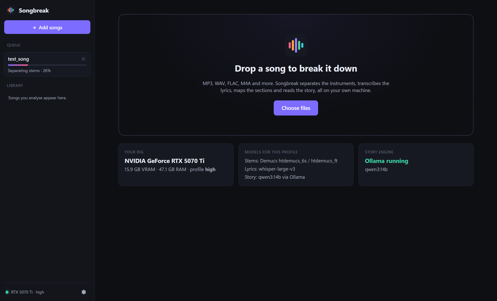

# Songbreak

**Break a song down into its instruments, lyrics, structure and story, entirely on your own machine.**

Drop in a track and Songbreak separates it into stems you can mix live, transcribes the lyrics
with word-level timing for karaoke playback, maps the sections (intro, verse, chorus, bridge…),
names the instruments playing in each one, and has a local LLM read the song as a story:
narrator, conflict, arc, themes. Nothing is uploaded anywhere.



| Karaoke lyrics | Story breakdown |
|---|---|
|  |  |

| Instruments per section | Queue and hardware |
|---|---|
|  |  |

## Features

- **Stem mixer.** Vocals, drums, bass, guitar, piano and "other", played in sample-accurate sync.
  Mute, solo, set volume, or A/B against the original recording.
- **Karaoke lyrics.** Whisper large-v3 runs on the isolated vocal only, and only where the singer
  is audible, which stops it inventing lyrics over instrumental parts. Lines and words light up as
  the song plays; click any line to jump there.
- **Song structure.** Tempo, key, and sections found from changes in the backing track. Repeats are
  matched by both sound and lyrics, so the same letter means the same musical material.
- **Instruments.** An AudioSet classifier run on each stem names what's actually playing in every
  section (synth, strings, brass…), plus vocal style, genre and mood.
- **Story.** Song form, point of view and energy arc always; with [Ollama](https://ollama.com), a
  local LLM adds the narrator, central conflict, a beat-by-beat arc, themes and literary devices.
- **Sized to your hardware.** Detects your GPU and picks model sizes that fit. Stages run one at a
  time and hand VRAM back in between, so a 16 GB card runs the largest models without spilling.

## Requirements

- Windows 10/11 (the engine itself is cross-platform Python; the installer is Windows-only for now)
- Python 3.10–3.13 installed (the app builds its own private environment from it)
- An NVIDIA GPU is strongly recommended. CPU works but is slow.
- About 10 GB of disk for the engine and models, plus about 400 MB per analysed song (the stems)
- Optional: [Ollama](https://ollama.com) for the narrative story breakdown

| Profile | VRAM | Stems | Lyrics | Story model |
|---|---|---|---|---|
| high | 14 GB+ | Demucs 6-stem, 2 shifts / `htdemucs_ft` | Whisper large-v3 | qwen3:14b |
| mid | 8 GB+ | Demucs 6-stem / `htdemucs_ft` | Whisper large-v3-turbo | qwen3:8b |
| low | 4 GB+ | Demucs 6-stem / `htdemucs` | Whisper large-v3-turbo | qwen3:4b |
| cpu | — | `htdemucs` | Whisper small | qwen3:4b |

On an RTX 5070 Ti (16 GB), a 96-second song takes about 75 s end to end once the models have
downloaded.

## Install

Download `Songbreak Setup x.y.z.exe` from [Releases](https://github.com/SkyTune96/songbreak/releases)
and run it. On first launch, choose **Install automatically**: Songbreak creates its Python
environment in `%LOCALAPPDATA%\Songbreak\venv` (about 5 GB with CUDA). Models download the first
time each one is needed.

The installer isn't code-signed yet, so Windows SmartScreen will warn about it. Choose
*More info → Run anyway*.

For story analysis, install Ollama and pull a model:

```bash
ollama pull qwen3:14b
```

## Build from source

```bash
git clone https://github.com/SkyTune96/songbreak.git
```

```bash
cd songbreak/app && npm install
```

```bash
npm run dev
```

`npm run dist` builds the installer into `app/release/<version>/`. The app looks for the engine's Python in
this order: the `SONGBREAK_PYTHON` environment variable, the path chosen in Settings, then its
own managed environment.

> **Windows path length:** keep the Python environment on a short path. torch's CUDA DLLs have long
> names, and a deep folder pushes them past the 260-character limit (`WinError 206`).

## Command line

The engine also works without the app:

```bash
python -m songbreak analyze "song.mp3"
```

Options: `--stems 4` (cleaner vocals, drums and bass), `--language en`, `--skip story,instruments`,
`--llm none`, `--profile mid`, `-o outdir`, `--force`. Output goes to `analysis/<song>/`: stems,
`lyrics.lrc`, `analysis.json` and a readable `report.md`.

## How it works

```
app/                Electron + React UI (TypeScript)
  src/main/         window, engine process manager, first-run installer
  src/renderer/     library, waveform, stem player (Web Audio), lyrics, story views
songbreak/          Python engine
  server.py         local HTTP API (127.0.0.1 only), job queue, live progress over SSE
  pipeline.py       load → stems → lyrics → structure → instruments → story → peaks
  stems.py          Demucs separation
  lyrics.py         vocal-activity gating + Whisper word timestamps
  structure.py      beats, key, checkerboard-novelty sections, repeat grouping, naming
  instruments.py    AST AudioSet tagging per stem and section
  story.py          heuristics + Ollama prompt/response
  hardware.py       GPU detection and model sizing
scripts/            test-song generator, icon renderer
```

The app starts the engine with `python -m songbreak serve`, which picks a free local port and
exits on its own if the app goes away. Each analysed song is a folder in your library
(`Music\Songbreak` by default) holding its stems, `analysis.json` and `report.md`.

## Known limits

- Section names are heuristic (the most-repeated vocal section with repeated lyrics is the chorus);
  the LLM pass corrects them when Ollama is running.
- Whisper can mishear heavily processed or screamed vocals. 4-stem mode gives a cleaner vocal stem.
- Demucs' guitar and piano stems are its weakest. Stems under 1% of the energy are flagged as bleed.

## Credits

Built on [Demucs](https://github.com/facebookresearch/demucs) (MIT),
[Whisper](https://github.com/openai/whisper) (MIT),
[AST](https://github.com/YuanGongND/ast) (BSD-3),
[librosa](https://librosa.org) (ISC), [Ollama](https://ollama.com) and
[Qwen3](https://github.com/QwenLM/Qwen3) (Apache-2.0).

## License

[MIT](LICENSE)
